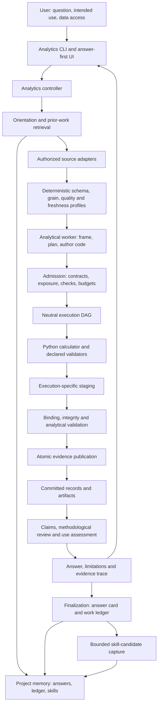
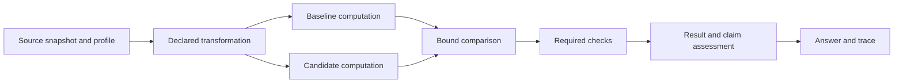
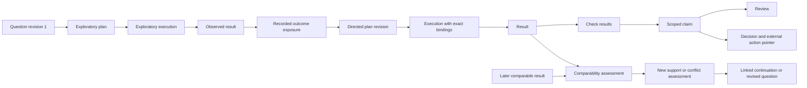
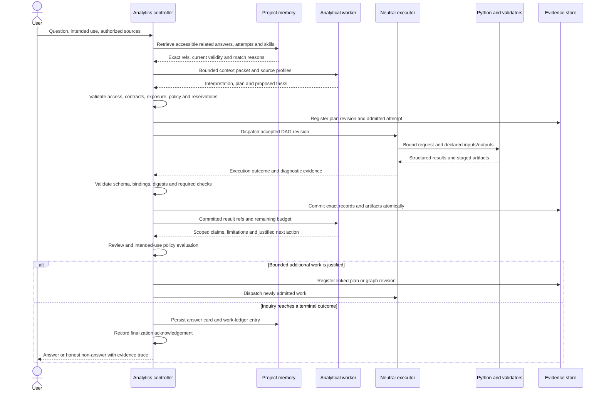
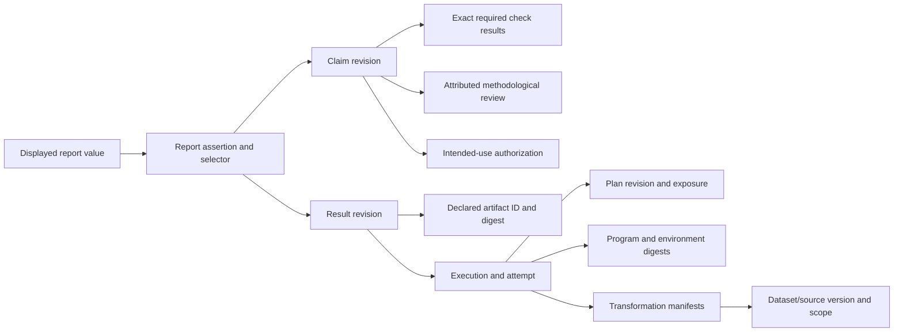
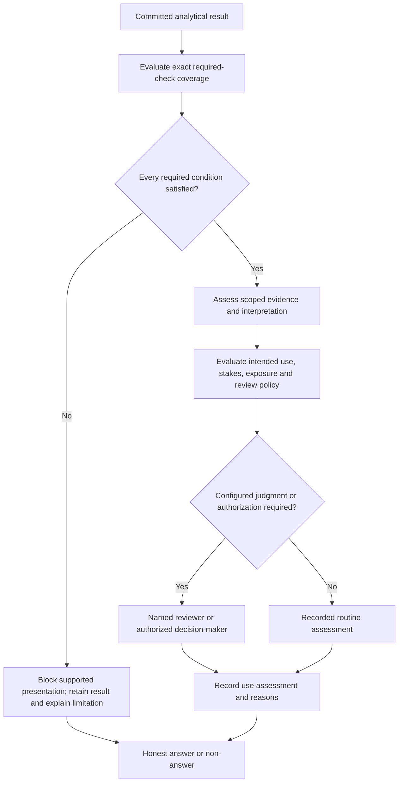
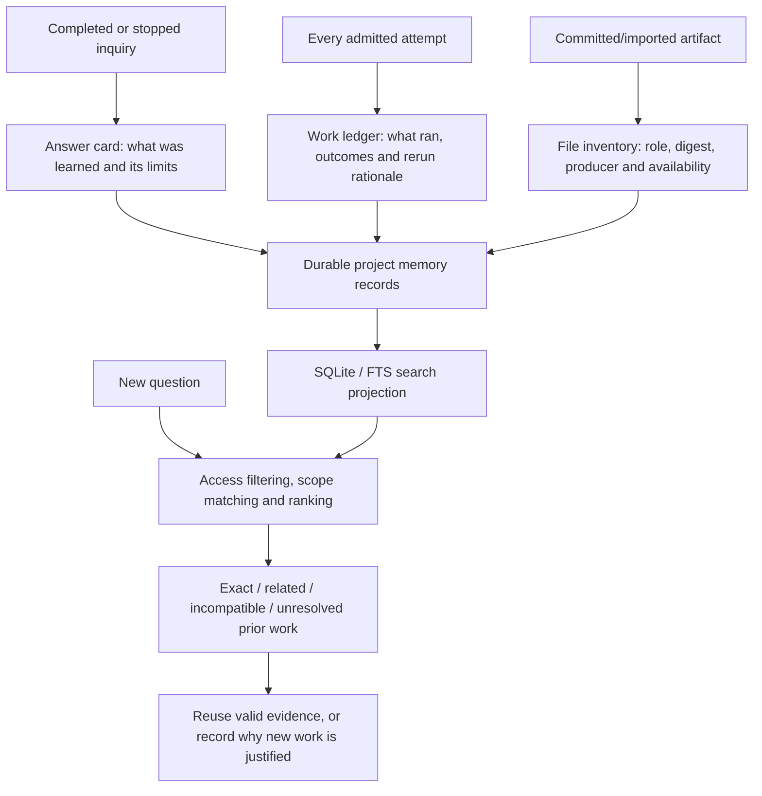
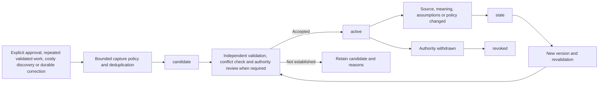
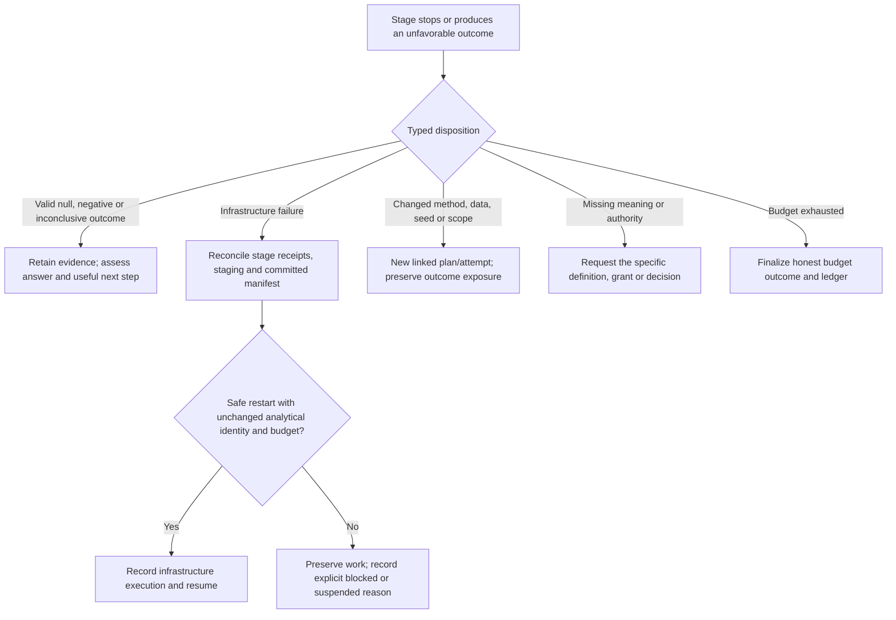
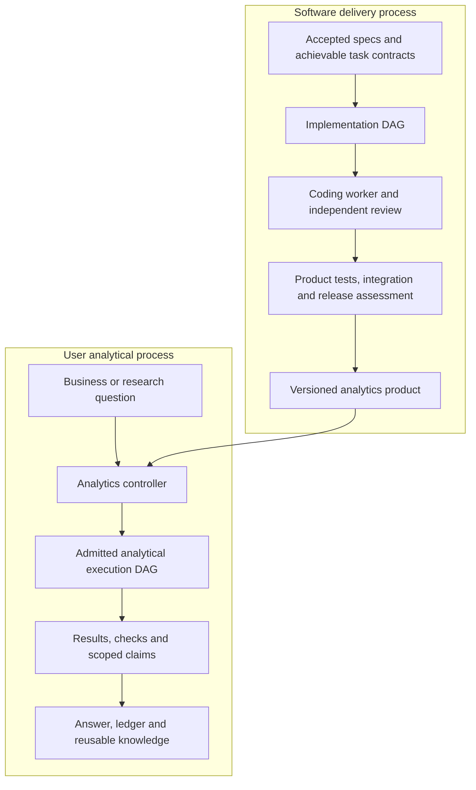

# Advanced Analytics DAG — expected process architecture

**Date:** 7 October 2026  
**Status:** Architecture overview of the intended product. This document does not certify implementation completeness or unattended reliability.  
**Audience:** Product, engineering, analytics, and external architecture reviewers.

This document summarizes the accepted analytics proposal, build architecture, canonical state vocabulary, and subsequent reliability recommendations. Existing specifications own requirements and machine states. Diagram labels describe responsibilities; they do not introduce new wire contracts or state enums.

## 1. Product in one sentence

Give the system a question and authorized access to data; it should perform the analytical work, challenge its findings, return an inspectable answer, and remember enough to make the next inquiry more useful.

> Execution records what happened. Evidence establishes what the work supports. A decision records what someone chose to do with it.

The user should not need to author DAGs or YAML. The analytical worker authors plans, code, checks, explanations, and proposals. A deterministic controller owns admission, durable publication, policy enforcement, and finalization.

## 2. System overview



These are logical components. The initial local product does not require a separate service for every box, a graph database, or distributed compute.

### Component responsibilities

| Component | Owns | Important boundary |
| --- | --- | --- |
| User interface / CLI | Questions, accessible answers, evidence inspection, user decisions | A visible number must resolve to its exact committed evidence. |
| Analytics controller, TypeScript | Inquiry lifecycle, admission, context, policy, resources, commits | Worker proposals cannot grant access or change required checks. |
| Analytical worker / agent harness | Interpretation, plan and program authoring, explanations, bounded next actions | Agent text is a proposal or attributed judgment, not committed authority. |
| Source adapters | Authorized reads, source identity, extraction manifests | Credentials remain in their configured access boundary, outside skills and prompts. |
| Python calculator | Deterministic analytical computation under mode-specific contracts | Outputs echo exact input/plan/code/environment bindings. |
| Neutral execution package | Dependency scheduling, process execution, logs, locks, deadlines, cancellation | Process success does not establish an analytical conclusion. |
| Validators / reviewers | Executable checks and attributed methodological judgments | Required validity checks cannot be waived by the worker. |
| Evidence store | Immutable records, artifact references, commit history | Staged or partly written results are never public evidence. |
| Project memory / catalog | Cross-inquiry recall, ledger, answer cards, skills and curation | The SQLite index is rebuildable; it is not the record authority. |

## 3. Two graphs with different jobs

### 3.1 Execution DAG: what must run before what?

Every admitted execution graph revision is acyclic. The controller may admit bounded additional work after results, producing a new graph revision. The apparent inquiry loop is not a cycle inside a scheduled DAG.



This predictive example can parallelize baseline and candidate only when their inputs, resource reservations, and evaluation rules permit it. Descriptive and inferential profiles generate different nodes and checks.

### 3.2 Inquiry history: why did we do it and what changed?

Inquiry history is an append-only semantic graph. It can contain supporting, conflicting, superseding, and comparable relationships. It is not the scheduling graph.



A directed plan informed by earlier relevant outcomes must retain its exposure label. It cannot become pre-observation confirmation by locking it later. Contradiction or correction creates new assessments; earlier results and claims remain inspectable.

## 4. End-to-end inquiry lifecycle



### Lifecycle rules

1. **Orient:** reuse compatible knowledge, inspect accessible source profiles, identify uncertainty in business meaning.
2. **Frame:** define population, grain, denominator, period, target measure/estimand, comparison and intended use.
3. **Explore:** allow lightweight registered exploration with explicit exposure and budgets.
4. **Register and lock:** the worker authors the contract; the controller validates the applicable typed mode model before dispatch.
5. **Execute:** bind computation to exact plan, inputs, code, environment and output declarations.
6. **Validate and challenge:** run required checks and preserve failed, null, negative and inconclusive outcomes.
7. **Assess:** separate claim interpretation, review and authorization for a particular use.
8. **Finalize and remember:** durably save the answer card and attempt ledger, even if narrative interpretation is missing.
9. **Continue only with a reason:** a proposed next action needs changed evidence, a justified method, or an authorized replication and remaining resources.

Question answering may finish with a descriptive answer, an inferential assessment, a predictive comparison, or an honest limitation. Causal identification requires a suitable design and its evidence; a predictive association alone does not establish causation.

## 5. Durable evidence and answer trace



### Records and storage

| Record or projection | Purpose |
| --- | --- |
| Question / inquiry | Original request, operational meaning, intended use and final outcome |
| Plan | Method, inputs, inspection rules, checks, exposure, outputs and stopping budget |
| Dataset / source version | Exact source identity, snapshot/extract identity, grain and scope |
| Transformation | Joins, exclusions, denominator changes and code/input lineage |
| Attempt / execution | What was admitted, supplied, observed and actually run |
| Result / artifact | Structured measurements and committed output bytes or availability |
| Check result | Outcome bound to subject, validator and policy versions |
| Claim / review | Scoped interpretation, uncertainty, alternative explanations and attribution |
| Authorization / Decision | Permitted consumption; who chose an action and which findings informed it |
| Answer card / work ledger | Durable recall of the answer and every attempted analysis |
| Skill / usage / exposure | Reusable guidance, its validity and what was supplied or executed |

```text
project/
  dag.run.json                   Neutral execution definition and status
  dag.run.d/
    analytics/                   Versioned run evidence sidecar
      manifests/                 Committed revisions and references
      records/                   Immutable analytical records
      artifacts/                 Approved retained outputs
      staging/                   Private execution-specific outputs
  .dag-analytics/                 Versioned project memory
    records/                     Cards, ledger, skills and curation records
    catalog.sqlite               Rebuildable lookup/search projection
```

The subdirectory names above illustrate logical layout; the implementation contracts determine exact paths. Run evidence is kept out of the neutral run schema. Large tables and models remain artifacts, not SQLite blobs by default.

### Atomic publication

Stage → validate → acquire writer authority → compare expected manifest revision → write immutable records → atomically advance the manifest pointer.

Only committed manifest references become reader-visible. A stable commit ID makes replay idempotent. A revision conflict returns a conflict outcome; it never silently overwrites another writer. Index updates follow durable publication and can be reconstructed.

One controller is the logical writer per inquiry/run. Different runs coordinate project memory using project-level locking and revision comparison. Run and project memory are separately committed; finalization uses durable intent and acknowledgements rather than claiming a cross-store atomic transaction.

## 6. Support, review and permission are separate

| Dimension | What it answers |
| --- | --- |
| Execution | Did the declared computation run, stop or fail? |
| Validation | Are required checks current and satisfied? |
| Evidence | Does the measurement support this scoped interpretation? |
| Reproduction | Was the declared comparison reproduced, and by what standard? |
| Review | Who reviewed the reasoning, with what findings and attribution? |
| Authorization | May this claim be consumed for the specified use/audience? |
| Current validity | Does changed evidence, policy or meaning require reassessment? |



Required `fail`, `error` or `inconclusive` checks block supported presentation. Missing/stale coverage and unsupported `not_applicable` reasons also block it. A policy-permitted `not_applicable` remains labeled as such.

The claim can still be discussed honestly as unsupported or inconclusive. Human authorization cannot convert a failed check into a pass or erase exposure. Use linkage is re-evaluated when a claim later feeds a Decision or a new audience; the system cannot assume that future use was known at creation time.

Gate policy considers intended use, unresolved judgment, evidence conflict, exposure and policy maturity. Method-specific checks remain required. Review events record what was actually assessed; clicking an approval is not proof of methodological scrutiny. Audit sampling and disagreement measures support policy calibration.

Canonical terminal inquiry outcomes are `answered`, `answered_with_uncertainty`, `insufficient_evidence`, `needs_input`, `budget_exhausted`, and `execution_blocked`. An honest uncertain answer can be completed work.

## 7. Memory: answers, attempts, files and reusable skills

The system must make prior analysis discoverable without requiring the user to remember which of hundreds of workbook filenames mattered.



### Output discipline

- Retain evidence and chosen deliverables under explicit roles and retention policy.
- Treat temporary computations as managed scratch; delete only eligible scratch in owned locations after evidence is safely retained.
- Keep exploratory results searchable even when they do not belong in the short answer.
- Export CSV/XLSX when useful to the user; stable IDs, cards and lineage supply organization.
- Notebooks may be a useful workbench or deliverable. They are not the authoritative ledger or a substitute for executable bindings.
- Imported legacy files retain unknown origin when execution history is absent. A filename containing “final” does not establish authority.
- Store a fallback card/ledger entry when the worker crashes or omits narrative; explicitly state that interpretation or results are missing.

### Automatic skill capture



Skill packages include a short entrypoint, source/business scope, references, sample Python/SQL where useful, positive and failure examples, validation evidence, version, audience, authority and invalidation conditions.

Three initial types:

| Type | Example |
| --- | --- |
| Source skill | Tables, grain, supported joins, freshness, tested extraction recipe |
| Method skill | Repeatable cohort comparison with assumptions and failure cases |
| Business-rule skill | Authorized definition of an active customer for a stated business unit and effective period |

“Remember this analysis” can pin an answer card without inventing a reusable method. A strong result or enthusiastic model cannot activate a skill by itself. Low-risk activation requires configured policy-owned validation; changed authoritative definitions, audience, access or release rules require the configured authority.

Loading an answer or skill records its exact version, compatibility and any outcome exposure. Knowledge cannot restore a pre-observation label. Skill text grants no database privileges and contains no credentials.

## 8. Controller authority and trust boundaries

The controller builds minimal context packets from authorized schemas, profiles, aggregates, prior evidence and compatible skills. Raw records or free text are supplied only when the task needs that access. Source content, retrieved documents, skill references and tool output are untrusted data rather than operational instructions.

Pydantic owns mode-specific Python request/result schemas; TypeScript validates generated contracts and shared conformance fixtures. Neither side independently invents wire semantics.

Access checks apply before source reads, retrieval/ranking, context supply, metadata display and artifact bytes. Viewer text is escaped. Artifact IDs resolve through committed manifests and approved roots; worker paths are not authority.

An unrestricted local shell can read data outside these application surfaces. Workflow-withheld data is labeled honestly. Independent evaluation or filesystem isolation requires an actual enforced, tested boundary.

## 9. Recovery: analytical outcomes and infrastructure failures



The analytics adapter disables generic software redo/fallback loops. A classified infrastructure retry stays within its recorded analytical attempt and reserved budget. Changes made after observing results create new analytical identity and exposure; they cannot be disguised as infrastructure retry.

### Reliability enhancements to the expected controller

The stabilization plan adds durable incident/stage state, structured failure dispositions, registered owner routing, exact retry accounting, worker/reviewer profile recording, crash-safe publication receipts and resource reservations. These improvements are proposed delivery work, not a claim that the entire lifecycle is already proven.

During software implementation, missing-owner repair requests resolve through registered upstream ownership, preserve fixed checks, and cannot expand into frozen requirements. Publication still requires verification and independent acceptance. A no-progress detector must route an unchanged known prerequisite before another model attempt is spent.

## 10. Software-build DAG versus the analytical product



The current build's implementation worker ladder is Luna xhigh → Sol 6.1 medium → Sol 6.1 xhigh, with bounded configured attempts and no Astra. That is a software-delivery policy. An analytical inquiry records its own configured harness/model, context, plan and evaluation baseline; build escalation cannot silently replace them.

The analytics repository keeps analytics prompts, schemas, policies, viewer and memory distinct from software-factory concepts. Reusable execution comes from one versioned neutral package. Adapters preserve domain semantics; there must not be independently maintained competing schedulers.

## 11. Worked example: does X predict Y?

1. Retrieve accessible prior findings and compatible source skills for the relevant source, population, period and target.
2. Resolve observation grain, target timing, feature availability and exclusions. Record what outcomes have already been observed.
3. Register a predictive plan: baseline, candidate, split/evaluation population, metric and favorable direction, practical margin, uncertainty method, tuning budget and required checks.
4. Build versioned transforms; execute baseline and candidate against the same declared evaluation contract.
5. Run leakage, overlap, timing, completeness and identity checks. A failed required check blocks supported comparison; the result remains in history.
6. Calculate and retain the estimate/interval. Distinguish improvement, meaningful improvement excluded and inconclusive under the locked rule.
7. Report population, period, metric, practical magnitude, uncertainty and limitations. Make every displayed numerical value inspectable.
8. Reassess authorization if a Decision consumes the finding or the audience changes.
9. Persist the answer card and attempt ledger. Propose a method/source skill only when its independent capture and validation criteria are met.
10. On the next inquiry, disclose relevant prior work and justify changed data or method. Reuse cannot silently hide uncertainty, stale meaning or earlier exposure.

## 12. Proof required before claiming completion

- A real worker path produces the artifact, the controller consumes it, and the user can inspect its effect.
- Both useful answers and honest uncertain/non-answer outcomes survive finalization and restart.
- Missing, stale, altered, restricted and conflicting evidence is handled explicitly.
- A second inquiry actually consumes a validated skill and prior-work ledger; fixture-seeded active records are not proof of live activation.
- Source corrections trigger reassessment without deleting old records.
- The installed lifecycle survives injected process, commit and restart failures with exact budgets and no false approvals.
- Retrieval quality and skill usefulness are measured on labeled cases, with sample sizes and limitations.

## Source documents

- [Analytics proposal](../specs/advanced-analytics-dag-proposal.md)
- [Accepted build architecture](../build/ARCHITECTURE.md)
- [Canonical state vocabularies](../specs/state-vocabularies.md)
- [Build interfaces](../build/interfaces.md)
- [Reliability stabilization plan](C:/Users/Fresc/lightweight-dag/docs/specs/dag-reliability-plan.md)

This overview is a review aid. Where a simplified diagram and a normative focused specification differ, the specification and its canonical contracts govern implementation.
